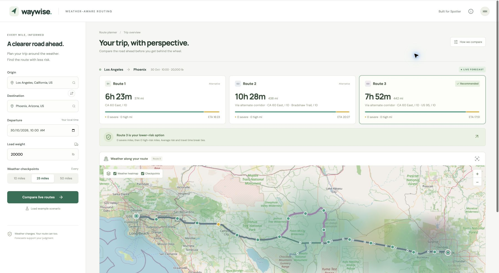

# Waywise · Spotter full-stack assessment

Repository: [0xhssn/spotter-weather-routing](https://github.com/0xhssn/spotter-weather-routing) (private).

A React + TypeScript and Django app that compares road routes using weather at each checkpoint's estimated arrival time, load-sensitive risk rules, and a preloaded 0–48 hour corridor forecast.



## Run locally

Requires Python 3.11+ and Node.js 22.12+.

```sh
cp .env.example .env
make setup
```

In two terminals:

```sh
make backend
```

```sh
make frontend
```

Open http://localhost:5173. The initial screen is a **labeled example** with three recorded LA–Phoenix road routes and simulated weather. **Compare live routes** calls the real providers; a failed provider never silently becomes example data. City search supports cities and postal codes, not street addresses.

## Docker

```sh
cp .env.example .env
docker compose up --build
```

Open http://localhost:8080. Nginx serves the built frontend and proxies `/api/` to Gunicorn/Django. No database is required: trip comparisons are read-only and have no saved accounts or trips.

For deployment, set `DJANGO_DEBUG=false`, a random `DJANGO_SECRET_KEY`, and the real hostname in `DJANGO_ALLOWED_HOSTS`. Put the web service behind your host's TLS reverse proxy. Deployment choice and Loom recording remain follow-up steps; nothing is published by setup.

## Features

- US city/postal-code autocomplete, explicit location selection, origin-local departure, load in pounds, and 10/25/50 mile spacing.
- Valhalla truck-profile alternative-route requests plus bounded waypoint detours when fewer than three alternatives are returned. Native and generated alternatives are deduplicated. Generated waypoints are through-points on major roads, with up to two bounded corridor widths; repeated and excessive detours are rejected. **Three distinct routes cannot be guaranteed for arbitrary endpoints.** The UI shows the actual count rather than cloning a route. When the truck provider rejects a long trip, an **unchecked-by-default checkbox** allows an OSRM car-profile comparison. It never activates for outages or without consent. The warning above the results and map popups state that truck restrictions are unchecked and travel times are car estimates. `ROUTING_PROVIDER=osrm` is also available as an explicit deployment setting.
- Arrival estimates use travel time distributed within individual routing steps, including slower sections and provider-supplied stationary maneuver time. Driver rest stops, traffic, and hours-of-service are not modeled.
- Checkpoints include origin and destination, including the final partial interval. Risk miles use the worse of adjacent endpoints across each road interval.
- Load-aware risk classification and a deterministic, lexicographic route recommendation. Any No Travel checkpoint disqualifies a route; if all routes are blocked, no recommendation is made.
- Leaflet road routes with a full-opacity selected line and white casing, zoom-aware checkpoints that retain every Moderate-or-higher point, and positional risk strips from origin to destination, keyboard-accessible checkpoint table, route-summary map popups, and corridor weather rendered on a canvas overlay. Cards expose average risk, and positive fractional risk mileage is never displayed as zero. Single-route results say so; High/Severe recommendations use caution colors. Provider notices appear above the cards.
- The heatmap has 49 precomputed hourly score frames. Low-risk fields are nearly transparent; Severe and No Travel fields are stronger and wider. Forecast state is isolated from cards and the checkpoint table, and route/marker layers are memoized. Slider movement, animation, and toggling layers do not make API calls or recompute route scores.
- Parallel, batched weather requests with bounded location counts; a shared 23-second provider budget with bounded timeouts and one short transient-error retry; cached geocoding/routing/weather and five-minute complete plans; explicit missing-forecast and upstream-error states.
- Responsive layout, keyboard city selection, reduced-motion support, accessible controls, and a keyboard-dismissable methodology dialog.

## Rules and interpretation

The implementation follows `docs/assessment.pdf`. The brief has shared rain/snow boundaries: exactly 0.25 in/hr rain is **High**, 0.50 is **Severe**; exactly 1 in/hr snow is **High**, 2 is **Severe**. These use the more conservative category. Exactly 1 in/hr rain and 3 in/hr snow remain **Severe**, since No Travel is strictly greater. Wind ranges are continuous (e.g. 34.9 is Moderate).

Wind ≥55 mph is always No Travel. Wind ≥45 mph with load **over** 30,000 lb is No Travel. Wind ≥35 mph with load **over** 40,000 lb is at least Severe. The maximum weather/load category wins. Gusts are displayed but the supplied rules use sustained wind.

Ranking, among eligible routes:

1. Fewest Severe miles
2. Fewest High miles
3. Lowest distance-weighted average score (Low=0 … No Travel=4)
4. Shortest provider travel time

No risk-mile rounding is used for ranking. A large number of low-risk checkpoints cannot outweigh a few high-risk miles through checkpoint-count bias.

Weather uses UTC Unix timestamps. Sustained wind and temperature are instantaneous provider values, linearly interpolated at each checkpoint ETA. Rain, showers, snowfall and gust maxima use the hourly bin ending at or after that ETA; precipitation peaks are not smoothed. This follows the [Open-Meteo variable definitions](https://open-meteo.com/en/docs#hourly-parameter-definition). Rain plus showers is converted mm → inches using 25.4; snowfall cm → inches using 2.54. Forecast units, contiguous hourly timestamps, complete coverage and finite values are validated before scoring. Missing, malformed or out-of-range forecasts cause an explicit service error; they are never replaced with zero or clamped to stale hours. The 48-hour corridor slider is anchored to departure and is separate from arrival-aware route scores. For trips longer than 48 hours, checkpoint forecasts still extend through final arrival; a visible note explains the shorter corridor timeline.

The corridor grid samples all routes every 40 miles with ±20 mile lateral offsets, increasing its spacing on long routes to stay under 240 grid samples and 1,800 total forecast locations. Checkpoint spacing is never thinned for scoring. A coarse canvas field uses the highest risk where sample areas overlap, independently of draw order; checkpoint values are the exact samples used for ranking. The grid and temporal bins are approximations, not proof that unsampled miles are safe.

## Providers and limits

No API key is needed for the assessment prototype:

| Purpose | Provider | Limit or consideration |
|---|---|---|
| Truck routes | [Valhalla / FOSSGIS](https://valhalla.github.io/valhalla/start/introduction/) public demonstration server | Limited fair-use assessment traffic; assumed semi dimensions and gross weight; no availability guarantee |
| Optional road adapter | [OSRM](https://project-osrm.org/docs/v5.22.0/api/) public demonstration server | Explicit car profile, not a silent truck-routing fallback |
| Hourly weather | [Open-Meteo](https://open-meteo.com/en/docs) | Free API is for noncommercial evaluation; respect current quotas and terms |
| City lookup | [Open-Meteo / GeoNames](https://open-meteo.com/en/docs/geocoding-api) | Select a city/postal code; disambiguate with state/country |
| Basemap | [OpenStreetMap](https://operations.osmfoundation.org/policies/tiles/) | Attribution and browser Referer remain visible; no offline prefetch; use a dedicated provider for larger deployments |

**This is not certified truck navigation.** Live Valhalla requests use `costing=truck`, exclude unpaved through-roads, and assume a standard semi: height 4.11 m, width 2.6 m, length 21.64 m, and gross weight = cargo + assumed 30,000 lb empty weight (converted to metric tons). Cargo separately affects the weather rules. Real vehicle dimensions, axle loads, trailer configuration, closures, and hours of service must be verified. The example uses recorded truck routes for a 20,000 lb load; changing example load recalculates weather risks, not the recorded road geometry.

For production, collect actual vehicle specifications, self-host the router or obtain a supported service plan, and arrange appropriate weather/hosting capacity. The Valhalla demo requests include `X-Client-Id`; set `ROUTING_CLIENT_ID` to the deployed application's identity and follow the demo operator's publication/fair-use guidance before opening it to end users. OSRM is available only if explicitly selected and is visibly labeled as a car profile.

Application limits: departure now to seven days ahead, routes up to 5,000 miles, load 0–100,000 lb, and at most 1,800 weather locations. The public truck router has its own shorter distance limit. Departure is entered in the origin’s IANA timezone; every trip time uses that zone and includes its abbreviation. Repeated or nonexistent DST local times are rejected with an explanation. The same minute-rounding rule is used for displayed durations and arrivals. LocMem caching and request throttling are per Gunicorn process. A scaled/public deployment should add shared Redis caching, perimeter rate limiting, observability, and appropriate provider capacity. New successful plans are limited to 30/minute per remote IP, with a fixed window. Complete-plan cache hits bypass throttling; validation failures and provider failures do not consume the budget. HTTP 429 includes Retry-After and the UI counts down. Behind Nginx, clients conservatively share the proxy’s remote-IP budget until trusted proxy/shared rate limiting is configured. JSON responses are gzip-compressed by Django and Nginx.

## API

| Endpoint | Contract |
|---|---|
| `GET /api/health` | Process readiness |
| `GET /api/places?q=Los%20Angeles` | Up to six US city choices; set `GEOCODING_COUNTRY` to change country scope |
| `POST /api/plan` | JSON origin/destination `{label,lat,lon}`, ISO departure with timezone, `load_lb`, `spacing_miles` |
| `GET /api/example?load_lb=20000&spacing_miles=25` | Explicit example with simulated weather |

Plans return source mode, inputs (including explicit `allow_road_fallback`), route routing profiles/geometry/checkpoints, risk mileages, recommendation ID or null, heatmap frames, warnings, and source metadata. Requests are stateless, same-origin, and do not mutate stored user data. There is no public arbitrary-URL proxy.

## Validation

```sh
make test
make build
.venv/bin/python backend/manage.py check
docker compose config --quiet
```

The 55 backend and 30 frontend tests cover threshold boundaries and fractional wind, strict load overrides, worst-condition behavior, No Travel exclusion, weighted mileage and partial intervals, recommendation tie-breaks, step-based ETA interpolation, forecast units/time bins, missing forecasts, input validation, upstream failure, the full example API contract, live orchestration at all three spacings, arrival-dependent route exclusion, malformed providers, route deduplication, stale city-search responses, city resets, timeline isolation, all-blocked UI, proxy errors, and heatmap overlap colors. See `docs/qa-fixes.md` for the latest QA fixes and checks; `docs/verification.md` records the earlier baseline.

## Structure

```text
backend/config/           Django configuration and URL wiring
backend/planner/risk.py   Pure risk scoring and recommendation
backend/planner/geometry.py  Road sampling and corridor geometry
backend/planner/providers.py Provider adapters, batching and cache
backend/planner/service.py   Trip orchestration, forecast matching
backend/planner/tests.py     Boundary and integration tests
frontend/src/            React UI, city search, Leaflet/canvas map
docs/                    Source assessment and walkthrough outline
```


## Deterministic visual QA and profiling

To reproduce the risk states without waiting for dangerous live weather, run `.venv/bin/python scripts/qa_fixture_server.py` from the project root. In another terminal run `cd frontend` then `API_PROXY_TARGET=http://127.0.0.1:8101 npm run dev -- --port 5175`. This separate local QA API serves **example data only**: load 20,000 lb for one Severe route; change to 30,001 lb and reload the example for No Travel. The production API never uses this harness.

For development render measurements, add `?qa-profile=1` to the normal frontend URL. Console messages record React commit duration and heatmap canvas draw duration. Production builds remove this diagnostic behavior. The automated tests assert that forecast ticks do not render the route cards, recommendation, or open checkpoint table.

GitHub Actions runs the backend tests, frontend tests, Django checks and production build on pushes to main and pull requests (`.github/workflows/ci.yml`).
